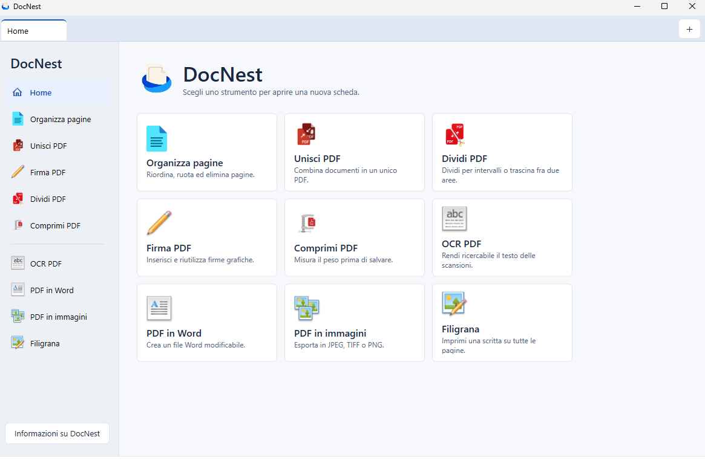

# DocNest

DocNest è un’applicazione Windows per lavorare con PDF, scansioni, immagini e documenti d’ufficio in un unico spazio.

## Cosa offre

- organizzazione visuale delle pagine con trascinamento, riordino, rotazione ed eliminazione
- unione e divisione dei PDF, anche con due aree per trasferire le pagine
- firma PDF con firme grafiche memorizzabili e riutilizzabili
- compressione, OCR, filigrana ed esportazione in PNG, JPEG e TIFF
- conversione PDF in Word e importazione di immagini, Word e PowerPoint
- schede indipendenti per lavorare su più documenti contemporaneamente
- anteprime con zoom e distribuzione Windows x64 autonoma

## Versione disponibile

La release pubblicata è la **0.4.0**. Il pacchetto installabile contiene l’app e i componenti OCR per italiano e inglese.

Scarica il setup da [DocNest-Setup-0.4.0-x64.exe](www.vr-m.it/app/pdf/servizio/DocNest-Setup-0.4.0-x64.exe).

## Collaborazioni aziendali

Il repository presenta il prodotto senza codice sorgente. Sono disponibili collaborazioni con aziende e organizzazioni per sviluppare il codice, integrare flussi dedicati, personalizzare il funzionamento e adattare logo e identità visiva.

Per informazioni: **Vincenzo Rosario Mellone** · [info@vr-m.it](mailto:info@vr-m.it) · [vr-m.it](https://www.vr-m.it/app/pdf/servizio/)

## Materiali

- [Articolo e descrizione del progetto](DocNest-articolo-e-descrizione-progetto.docx)
- [Immagini per l’articolo](media/)
- [Licenza DocNest](LICENSE.md)

## Note

Il repository è una vetrina pubblica e non contiene il codice sorgente dell’applicazione. L’uso, la redistribuzione del setup e le personalizzazioni sono regolati dalla licenza inclusa.

